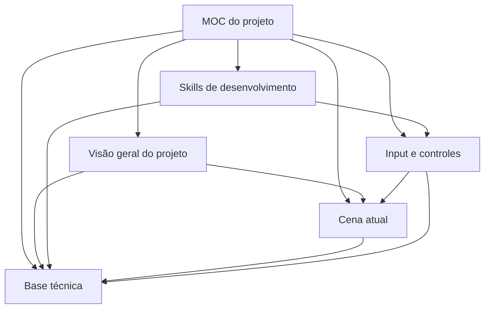

# MOC do projeto

Índice principal do second brain de **Ho and the Bells Guardians**. As notas descrevem o estado confirmado do repositório e apontam lacunas sem presumir funcionalidades.

## Visão geral

- [[01 - Visão geral do projeto]] — identidade do projeto e estado atual.
- [[04 - Base técnica]] — versão do Unity, renderização, pacotes e organização.
- [[05 - Skills de desenvolvimento]] — skills de agente disponíveis e compatibilidade.

## Conteúdo do jogo

- [[02 - Cena atual]] — cena configurada para abrir e incluir nos builds.
- [[03 - Input e controles]] — mapas, ações e bindings configurados.

## Grafo

## Como manter

Consulte esta página como ponto de entrada. Ao acrescentar uma nota, ligue-a aqui e a pelo menos uma nota relacionada. Veja também as instruções em [[../../AGENTS|AGENTS.md]].
