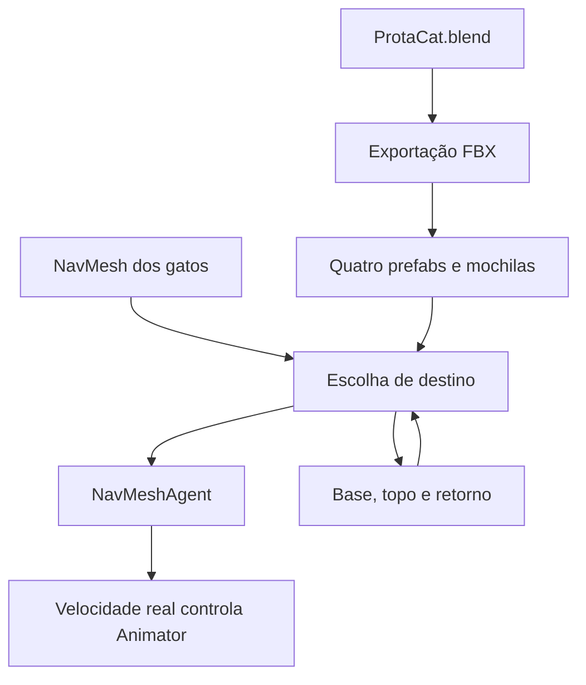

# Gatos NPCs

## Conteúdo confirmado

- A `SampleScene` contém `Cat NPC Demo`, com um NPC para cada modelo: `G.Calda Fina`, `G.Calda Grossa`, `G.Calda Grossa-Gordo` e `G.Calda Reta`.
- A origem é `ProtaCat.blend`, na pasta externa `1-Projetos Blender/Projetos-Blender/Gatos`. O projeto usa uma exportação independente em `Assets/Art/Cats/ProtaCat.fbx`; não depende da importação direta de `.blend`.
- O arquivo contém um esqueleto compartilhado de 23 ossos e os clipes `Idle`, `Walk` e `Run`, a 24 FPS. A importação usa rig Generic, loops e root motion desativado.
- O gordinho usa `Bolsa.001` e `AlçaBolsa.001`. Os demais usam `Bolsa` e `AlçaBolsa`. Mochilas e alças são malhas com pesos no mesmo esqueleto.
- A origem não contém materiais nem texturas. Os materiais URP/Lit do projeto usam cores simples para distinguir os modelos; não representam uma textura final de personagem.
- A exportação corrige oito vértices sem pesos (um por gato e dois por alça), copiando e normalizando os pesos do vértice ponderado mais próximo na mesma malha. Isso evita a associação automática ao osso zero pelo importador. As correções ficam no FBX e no manifesto; o `.blend` original não é salvo.

## Comportamento e navegação

- `CatNpcWander` alterna caminhada a 1,2 m/s, corrida a 2,8 m/s e pausas de 2–5 s. A chance de corrida por deslocamento é 25%.
- Todos passeiam entre destinos no pátio e nos distritos. Após três destinos comuns, visitam uma escada, sobem até o topo e retornam à base; as visitas alternam entre as duas escadas.
- Cada gato possui sua faixa de aproximação nas escadas. Caminhos incompletos são rejeitados; ausência de progresso por 8 s faz o NPC abandonar o destino e tentar outro após uma pausa.
- O Animator é orientado pela velocidade real do NavMeshAgent. O Inspector expõe o estado e os contadores de subida/descida; selecionar o NPC mostra gizmos dos destinos e das rotas.
- `Cat Navigation` usa AI Navigation 2.0.15, agente `Cat NPC` com raio 0,28 m, altura 1,35 m, degrau máximo 0,3 m e inclinação de 45°. A superfície usa colliders, voxel de 0,045 m e HeightMesh.
- A escala visual é 0,25, com cerca de 1,3 m de altura. Um raycast apoia a raiz visual nos degraus reais e compensa o pequeno deslocamento vertical dos clipes de locomoção. Não há IK individual das patas nem colisão física de interação com o jogador; os gatos usam avoidance entre agentes.
- Estes testes verificam os NPCs com NavMeshAgent. O jogador usa CharacterController e continua com sua validação própria em [[06 - Player e câmera]].

## Como reproduzir

1. Abra `Assets/Scenes/SampleScene.unity` e entre em Play Mode. Dois gatos começam no pátio e dois perto da entrada dos distritos.
2. Observe as escadas do pátio em X=-5 e as do distrito em X=4. As visitas são ocasionais durante o passeio.
3. Se a geometria mudar, saia de Play Mode e use `Tools > Ho and the Bells > Configure Cat NPCs`. O comando regenera a demonstração e salva a cena; os prefabs e materiais mantêm seus caminhos.
4. Para reexportar, use `Tools/Cats/export_cats.py` com Blender em `--background --factory-startup`, passando o arquivo original e `-- Assets/Art/Cats`. O script não salva o `.blend` e inclui os objetos ocultos para seleção.
5. As ferramentas de inspeção e teste ficam em `Tools/Cats`. O cliente `unity_mcp.py` inicia uma conexão stdio temporária da CLI oficial, fixada neste projeto; não registra servidores MCP globais. Relatórios e imagens de teste ficam em `Temp/CatValidation`.

## Validação

- Importação conferida: quatro modelos, três clipes em loop, avatar Generic válido e mochila/alça correspondentes.
- Os quatro modelos tocaram `Idle`, `Walk` e `Run` em Play Mode, com avanço de frames e deslocamento real.
- Em 21/11/2026, o teste via MCP avançou de 1.175 para 11.628 frames e observou 168,8 s de tempo simulado, com aceleração temporária de 3x. Os quatro modelos tocaram os três clipes.
- As oito combinações de modelo e escada completaram subida e descida: os quatro chegaram à escada do distrito (1,5 m); os quatro também atravessaram a escada do pátio (1,25 m), sendo o retorno do modelo de cauda reta confirmado em uma repetição isolada do tráfego dos demais NPCs.
- O teste simultâneo registrou abandonos temporários de destino por falta de progresso (0–3 por gato no relatório), seguidos de retomada do passeio. A repetição isolada do modelo de cauda reta concluiu subida e descida sem aumentar seu contador de falhas. Isso não constitui prova de ausência de congestionamentos em qualquer configuração futura.
- As imagens das duas escadas foram inspecionadas visualmente. Relatórios locais: `Temp/CatValidation/stairs.json`, `straight-tail-retest.json` e `observation.json`; capturas `stairs-1.png` e `stairs-2.png`. São artefatos temporários, não dependências da cena.
- Após corrigir os pesos na exportação, a checagem da cena salva confirmou quatro NPCs, 12 destinos por NPC, duas rotas completas em ambos os sentidos por modelo, avatar válido e dados de navegação persistidos. A compilação terminou sem falhas e o Console atual ficou com zero erros e zero avisos. O Editor foi deixado fora de Play Mode, com atualização forçada desligada.

## Relações

- [[02 - Cena atual]] — mapa e escadas usadas pelos NPCs.
- [[04 - Base técnica]] — versão do Unity e pacotes.
- [[00 - MOC]] — índice do projeto.
